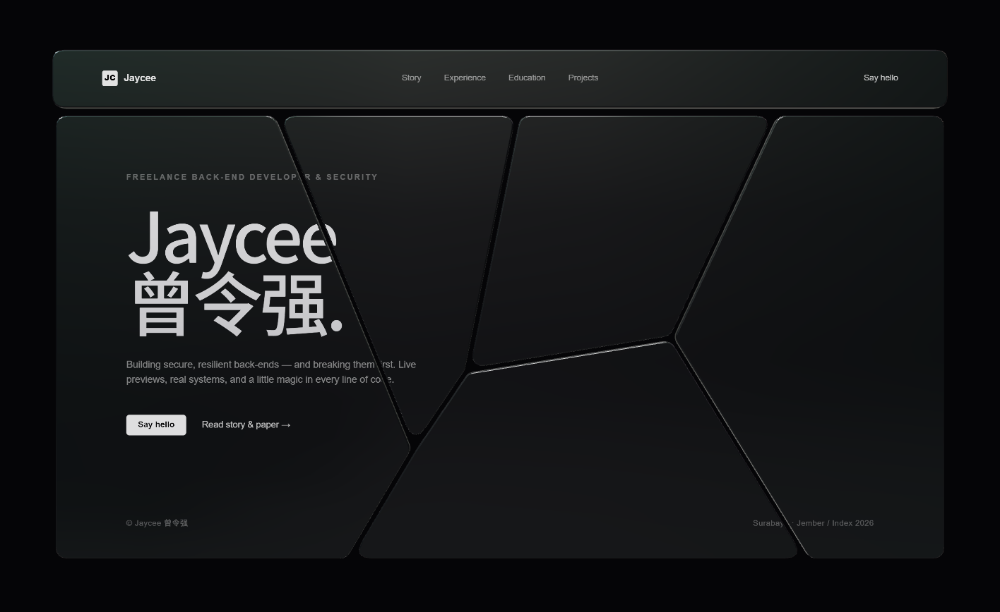
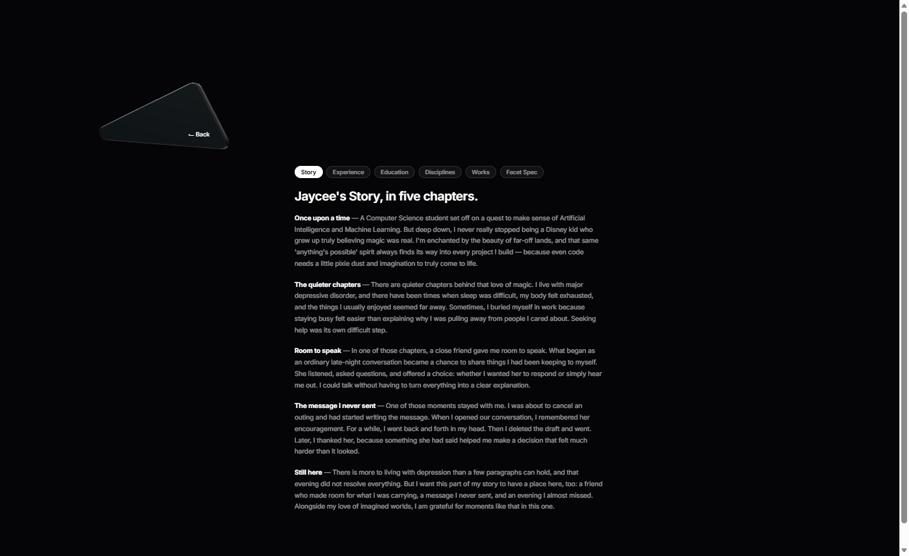

# glass-myblog — Designed in Glass WebGL Hero

[](https://threejs.org/)
[](https://www.khronos.org/webgl/)
[-success)]()
[](LICENSE)

An interactive, high-fidelity **WebGL hero website** for **Jaycee 曾令强** (Freelance Back-end Developer & Penetration Tester), built according to the **Facet "Designed in glass"** hero architectural specification.

The viewport renders a dark website shattered into **thick smoked-glass shards floating on pure velvet black (`#050507`)**. Content is printed directly onto the 3D glass faces. The monolithic slab tilts toward the cursor, individual shards spring up and tip with an iridescent sheen and custom lavender shader glow on hover, and clicking **"Read story & paper →"** shatters the page into 3D space to reveal a secondary definitions view.

---

## ✦ Visual Gallery

### 1. Hero View — Thick Smoked Glass Shards & Live Cut Pattern


### 2. Shatter View — Outward Trajectory & Definitions View on Black


### 3. Reassembled View — Smooth Return with Ease-Out-Back


---

## ✦ Key Architectural Features

### 1. Scene & Perspective Scaling
- **Background:** Pure black `#050507`.
- **Camera:** Perspective camera ($30^\circ$ FOV), calibrated so that **$1\text{ world unit} = 1\text{ CSS px}$ at $z = 0$** ($D = \frac{H}{2 \tan(15^\circ)}$).
- **Depth Buffer Precision:** Calibrated `near: 10` and `far: 6000` to maximize 24-bit depth precision and prevent depth clipping.
- **Tone Mapping:** `ACESFilmicToneMapping` with DPR capped at 2.0.
- **Environment & Key Light:** PMREM `RoomEnvironment` with `environmentIntensity = 0.42`, accompanied by a soft directional key light (`#e4edff`, intensity 1.8) from top-left and an ambient fill light (`#1a1a24`).
- **Page Slab:** Centered with 5.5% side margins and 8.5% top/bottom margins (16px on mobile):
  - **Nav slab:** 10.8% of block height
  - **Gap:** $14 \cdot S$ px
  - **Shard panel:** The rest of the block height
  - **Layout Scale:** $S = \text{blockWidth} / 1730$.

### 2. Smoked Glass & Shader Injection
- **Physical Glass Construction:** Extruded rounded polygons with corner radius $20 \cdot S$, depth $13 \cdot S$, and a $2.6 \cdot S$ 3-segment bevel (`curveSegments: 4` for 60 FPS performance).
- **Physical Material Properties (`MeshPhysicalMaterial`):**
  - Charcoal base `#17171b`, roughness `0.36`, clearcoat `0.7`, clearcoatRoughness `0.12`, specularIntensity `0.7`.
  - Iridescence `0.55` (IOR 1.3, thickness 250–650 nm), ramping to **1.0** and envMapIntensity $1.0 \to 1.9$ on hover.
- **Cursor Glow:** Custom lavender emission injected into the Three.js physical shader via `onBeforeCompile`:
  $$\vec{c}_{\text{glow}} = \text{vec3}(0.42, 0.37, 0.62) \cdot 0.16 \cdot \exp\left(-1.6 \cdot \left(\frac{d}{300 \cdot S}\right)^2\right)$$
  Smoothly tracks the cursor unprojected at $z = 0$.

### 3. Live Sinusoidal Cut Pattern
- **Five Cells:** Measured precisely from normalized coordinates:
  - Top edge points: $t_{AB} = 0.22$, $t_{BC} = 0.515$, $t_{CE} = 0.84$
  - Bottom edge points: $b_{AD} = 0.34$, $b_{DE} = 0.865$
  - Inner junctions: $J_0 = (0.385, 0.72)$, $J_1 = (0.48, 0.62)$, $J_2 = (0.716, 0.49)$
  - Cells: $A$ (hero), $B$, $C$, $D$, $E$.
- **Breathing Drift:** Real-time sinusoidal motion ($x \pm 0.03$, junctions $y \pm 0.05$, periods 10–20s).
- **Cursor Push-Away:** Vertices within 0.6 normalized distance from the pointer are pushed away by up to 0.05, expanding the hovered shard.
- **Portrait Transposition:** Automatically transposes coordinates on portrait viewports so the hero cell sits on top.

### 4. 8-DOF Projective Homography & Z-Fighting Immunity
- **Printed Text Decals:** High-DPR (2.0) canvas drawing with 100% transparent background outside glyphs. Each cell carries a `ShapeGeometry` decal just above the glass top face with UVs mapped to the page image.
- **Eliminating Z-Fighting:** Decal materials use GPU `polygonOffset: true, polygonOffsetFactor: -4, polygonOffsetUnits: -4` with a $1.2 \cdot S$ physical standoff, delivering crystal-clear typography with zero stippling, flickering, or noise.
- **HOMOGRAPHY DOM Overlay:** An 8-DOF Gaussian elimination perspective solver maps a transparent DOM layer onto the tilted 3D panel using CSS `matrix3d(...)` every frame. Text is natively selectable (with blue selection highlight), and links/buttons have real interactive hitboxes.

### 5. Shatter Physics & Secondary View
- **Spring Physics:** Hovered shards spring up $50 \cdot S$ ($32 \cdot S$ for nav) with underdamped spring ($k = 170, c = 19$) and tip up to $\pm 0.24$ rad dipping away from the pointer.
- **Outward Shatter Trajectory:** Clicking "Read story & paper →" propels shards outward (left pieces fly far left, right pieces fly far right, nav flies up) with ease-in cubic (0.72s), downward gravity, $420–800 \cdot S$ $z$-velocity, and random tumble, completely clearing the central column.
- **Secondary View on Black:**
  - Column starts at **32.4% W** and is **33.9% W** wide.
  - Title baseline sits precisely at **35.9% H**.
  - Paragraphs typeset at $0.73\text{ vw}$ with $1.72$ line-height, 60% white, and $1.05\text{ vw}$ gaps.
  - Features Jaycee's **Five Chapters** (*Once upon a time*, *The quieter chapters*, *Room to speak*, *The message I never sent*, *Still here*), alongside **Experience** (6 roles), **Education**, **Disciplines**, and **Works**.
- **"← Back" 3D Sliver:** Smoked glass shard at $(0.219 W, 0.238 H)$ extruded by $11 \cdot k$, leaning at $\text{rotY} = -0.16, \text{rotX} = 0.08$ with a $\pm 0.035$ rad idle wobble. Hovering turns the text lavender (`#b9abff`). Clicking it reassembles the hero with ease-out-back (slight overshoot) and a 30ms stagger.
- **Brand Mode Toggle:** Click the brand mark in the top-left nav to toggle between **Jaycee's Portfolio** and the literal **Facet "Designed in glass"** studio specification.

---

## ✦ Project Structure

```
glass-myblog/
├── index.html              # Clean semantic HTML, importmap, DOM overlays & fallback
├── style.css               # Modern CSS, typography, responsive rules, matrix3d overlay
├── server.js               # Lightweight zero-dependency HTTP static server
├── package.json            # Scripts & project metadata
├── README.md               # Complete architecture & design documentation
├── docs/
│   └── screenshots/        # High-resolution visual verification captures
│       ├── hero.png
│       ├── shatter.png
│       └── reassemble.png
├── public/                 # Favicons and avatars
└── src/
    ├── app.js              # Three.js orchestration, physics, homography sync, transitions
    ├── canvas-renderer.js  # High-DPR 2D canvas drawing (text, buttons, dynamic nav spacing)
    ├── cut-pattern.js      # Live 5-cell geometry, sinusoidal drift, cursor push, filleting
    ├── data.js             # Jaycee's 5 chapters, roles, education, skills, projects, Facet terms
    ├── homography.js       # 8-DOF projective matrix3d solver (Gaussian elimination)
    └── materials.js        # MeshPhysicalMaterial smoked glass & onBeforeCompile shader glow
```

---

## ✦ Getting Started

### Prerequisites
- Modern web browser with WebGL 2.0 support (Chrome, Edge, Firefox, Safari).
- Node.js (optional, for local static serving).

### Running Locally (Zero Build Step)

No build tools, bundlers, or package installations needed.

```bash
# 1. Clone the repository
git clone https://github.com/ZengLLQ/glass-myblog.git
cd glass-myblog

# 2. Start the local server
node server.js

# Or with python:
# python -m http.server 3000

# Or with npx:
# npx serve .
```

Navigate to `http://localhost:3000` in your browser.

---

## ✦ Keyboard & Interaction Shortcuts

- **Mouse Move:** Tilts the entire monolithic slab toward the pointer.
- **Shard Hover:** Lifts the hovered glass piece by $50 \cdot S$, tips it away from the cursor, ramps iridescence to 1.0, and emits lavender cursor glow.
- **Click "Read story & paper →":** Triggers 0.72s cubic shatter into the secondary view.
- **Click "← Back" Sliver:** Reassembles the glass shards back into the hero view.
- **Click "JC Jaycee" Logo (Top-Left):** Toggles between Jaycee's Personal Portfolio and the Facet Spec mode.
- **Section Tabs:** Click any tab in the secondary view to switch between Story, Experience, Education, Disciplines, Works, or Facet Spec.

---

## ✦ Accessibility

- **Reduced Motion:** Fully supports `prefers-reduced-motion: reduce`. Automatically skips 3D WebGL animations and serves a styled, high-contrast, accessible HTML portfolio (`#static-fallback`).
- **Screen Readers:** All interactive controls maintain full ARIA attributes, semantic buttons, and labels.
- **Native Selection:** Transparent DOM homography layer enables native text selection, copy-pasting, and right-click context menus.

---

## ✦ License

MIT License. Designed & Developed by **Jaycee 曾令强** (2026).
